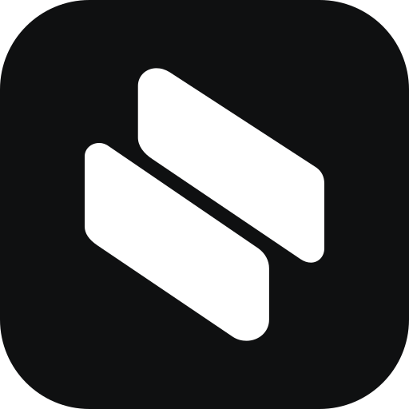

<p align="center">
  
</p>
<h1 align="center">Rinia</h1>
<p align="center"><b>A calm workspace for projects, issues, and docs</b></p>

<p align="center">
    <a href="#-getting-started"><b>Getting started</b></a> •
    <a href="#-features"><b>Features</b></a> •
    <a href="https://github.com/alty-oss/rinia/issues"><b>Issues</b></a>
</p>

<br />

Rinia keeps each project in one place: an issue tracker with list and board views, a document editor, and the people working on it. No setup rituals, just a dark, fast interface that stays out of the way.

## 🌟 Features

- **Issues**
  Track work with project-scoped IDs such as `TK-184`. Switch between a list and a Kanban board, filter by assignee or label, and open any issue in a side peek without losing your place.

- **Documents**
  Write project pages in a block editor with slash commands, tables, and images. Changes save as you type, and drafts survive a refresh.

- **Projects**
  Give every project an icon, color, and banner. Invite members, manage labels, and follow the activity history.

- **Made to feel at home**
  Dark and light themes, keyboard shortcuts, and an interface in English and Portuguese.

## 🚀 Getting started

### Docker

The `Dockerfile` builds the web app and the API into a single image and applies pending migrations on startup.

```bash
docker build -t rinia .
docker run -p 3000:3000 \
  -e DATABASE_URL=postgres://... \
  -e JWT_SECRET=... \
  -e SPECIAL_REGISTRATION_CODE=... \
  rinia
```

### Local development

You need [Bun](https://bun.com) 1.3.14+ and PostgreSQL.

```bash
bun install
docker run --name rinia-db -e POSTGRES_PASSWORD=postgres -e POSTGRES_DB=rinia -p 5432:5432 -d postgres:16
bun run db:migrate
bun run db:seed
```

The seed creates three projects with issues, labels, and documents, plus the accounts `admin`, `ana`, and `bruno`, all with the password `rinia1234`. Run `bun run db:reset` to drop the database and seed it again. Both commands refuse to run with `NODE_ENV=production` or against a database that is not on your machine.

Then start the API and the web app in separate terminals:

```bash
bun run dev:api   # http://localhost:3000
bun run dev:web   # http://localhost:5173
```

### Environment variables

Set these in `apps/api/.env`, or pass them to the container.

| Variable | Description |
| --- | --- |
| `DATABASE_URL` | PostgreSQL connection string |
| `JWT_SECRET` | Secret used to sign sessions |
| `JWT_EXPIRES_IN` | Session lifetime, for example `7d` |
| `SPECIAL_REGISTRATION_CODE` | Code required to create an account |
| `ADMIN_USERNAMES` | Comma-separated admin usernames |
| `PORT` | API port, default `3000` |
| `APP_URL` | Public address of Rinia, used for links in MCP results. Defaults to the address each request came to |

### Connect Claude Code (MCP)

Rinia has an [MCP](https://modelcontextprotocol.io) server at `/api/mcp`, so Claude Code and other AI tools can read and change your projects. They act as you: they see the projects you are a member of and can do what you can do.

1. In Rinia, open **Settings → Integrations → All integrations** and pick your tool (Claude Code, Claude, VS Code, Codex, Gemini CLI, or any other MCP client). Its page creates a token and fills it into the setup steps. Copy it right away; it is shown only once. Tokens are listed and revoked in **Settings → Integrations → API tokens**.
2. Add the server to Claude Code:

   ```bash
   claude mcp add --transport http rinia https://your-rinia-host/api/mcp --header "Authorization: Bearer rinia_..."
   ```

   For local development, use `http://localhost:3000/api/mcp`. Add `--scope user` to use Rinia from every folder.
3. Ask in plain words, for example "lista minhas tarefas em andamento" or "comenta na RIN-4 que o deploy terminou".

| Tool | What it does |
| --- | --- |
| `list_projects` | Projects with their key, states, labels and members |
| `list_issues` | Issues, filtered by project, state, assignee (`me`), priority or label |
| `get_issue` | One issue with its description, sub-issues, relations and comments |
| `search` | Issues and pages that contain the words, or an issue by its identifier |
| `get_document` | A page as Markdown |
| `create_issue` | Creates an issue |
| `update_issue` | Changes state, assignee, priority, labels, title, description, due date or parent |
| `add_comment` | Comments on an issue, or replies to a comment |
| `create_document` | Creates a page from Markdown |

Results name issues by identifier (`RIN-4`) and link to them in Rinia. Revoking a token on the API tokens page cuts off whatever uses it at once. The same token also works with the REST API as `Authorization: Bearer <token>`.

## ⚙️ Built with

[](https://react.dev/)
[](https://vite.dev/)
[](https://www.typescriptlang.org/)
[](https://tailwindcss.com/)
[](https://bun.com/)
[](https://expressjs.com/)
[](https://orm.drizzle.team/)
[](https://www.postgresql.org/)

## 🤝 Contributing

Found a bug or have an idea? [Open an issue](https://github.com/alty-oss/rinia/issues). Commits and pull requests follow Conventional Commits; see [AGENTS.md](./AGENTS.md).

Before opening a pull request, run:

```bash
bun run typecheck
bun run test
bun run build
```

`bun run test` never touches a database. Migrations and transactions are tested against PostgreSQL with `bun run test:db`: point `TEST_DATABASE_URL` at a local server where you can create databases, for example the `postgres` database of the container above. Each run creates its own database and drops it afterwards; without the variable those tests are skipped.
